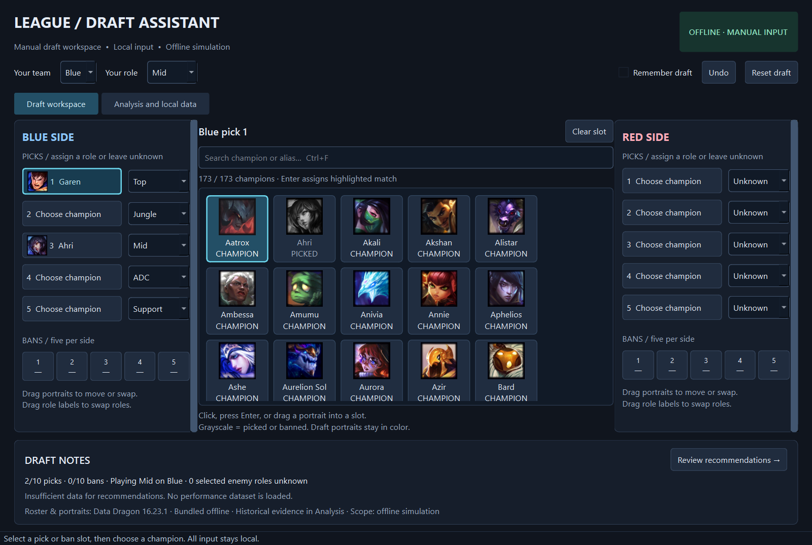
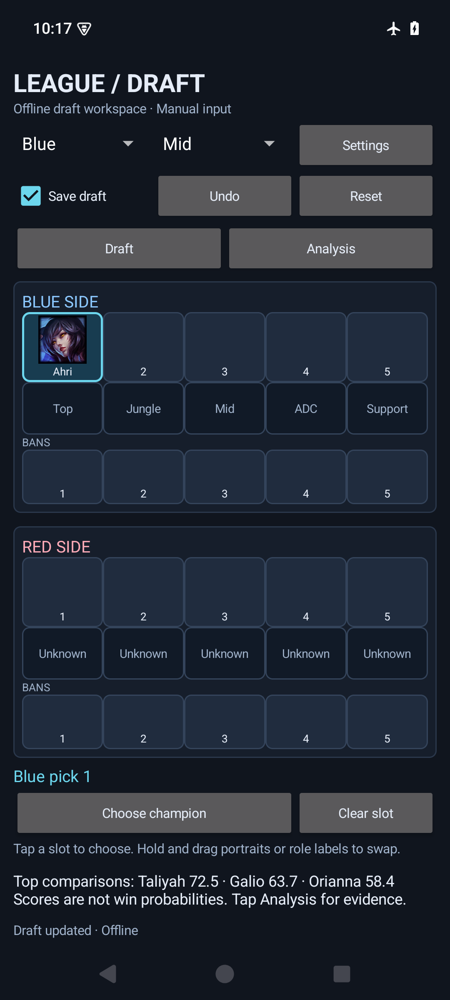
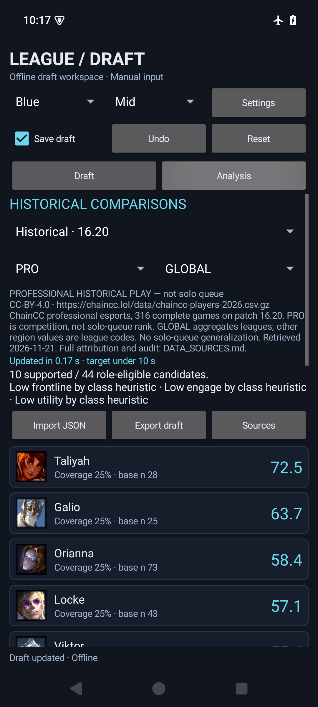

# League Draft Assistant

An offline League of Legends ban/pick workspace for **Windows and Android**. Build a draft, move champions and roles, and inspect recommendations with the observations behind them.

**The idea:** help everyday players choose a practical champion for their role, the opposing lane and their team's needs, quickly enough to use between picks. A useful counter should fit both the matchup and the person playing it. The intended direction is rank-appropriate solo-queue evidence combined with champion familiarity and difficulty controls.

> **Current data status:** the working builds still bundle historical **professional-play** data. Average-player ranked data and counters have been requested but are **not implemented yet**. Existing rankings must not be interpreted as average-player recommendations. See the [roadmap](docs/ROADMAP.md).

[Project idea](docs/IDEA.md) · [Windows guide](docs/windows-guide.md) · [Android guide](android/README.md) · [Scoring](docs/SCORING.md) · [Data sources](DATA_SOURCES.md) · [Architecture](docs/ARCHITECTURE.md) · [Testing](docs/TESTING.md)

## Features

| Area | Implemented behavior |
| --- | --- |
| Draft board | Five picks and five bans per side; partial drafts; known and Unknown roles |
| Champion picker | 173 bundled portraits, canonical/alias search and grayscale used champions |
| Editing | Drag champions to move/swap; drag role labels to swap roles; clear, undo and reset |
| Validation | Atomic rejection of duplicate picks, banned picks, duplicate own-team bans and conflicting roles |
| Recommendations | Role-specific lane matchup, other enemies, ally synergy, composition, baseline and blind robustness |
| Explanations | Raw wins/games, smoothed pair rates, residuals, coverage and missing-evidence warnings |
| Local data | SQLite; validated JSON/CSV import; exact dataset/patch/rank/region filters; idempotent reimports |
| Recovery | Local preferences; optional desktop draft recovery; Android draft saving enabled initially |
| Platforms | Native PySide6 Windows UI and native Java Android UI sharing one Python core |
| Privacy | Offline runtime; no login, telemetry or client integration; Android has no Internet permission |

This is a deterministic statistical tool, with no trained machine-learning model. Scores are comparative indices, **not win probabilities**. Missing observations stay missing.

## Screenshots

### Windows



### Android

<p>
  
  
</p>

Screenshots show the current professional-data build, not the planned average-player version.

## Install a build

Downloadable builds, when published, belong on the [Releases page](https://github.com/Haoran-M/League-of-legends-Ban-Pick-helper/releases). Generated binaries are excluded from source control; a source ZIP is not an installable app.

| Platform | Build artifact | Requirements |
| --- | --- | --- |
| Windows | `LeagueDraftAssistant.exe` or `LeagueDraftAssistant-portable.zip` | Windows 10/11 x64; no separate Python needed |
| Android | `LeagueDraftAssistant.apk` | Android 8.0+; 64-bit ARM64 or x86_64; Python bundled |

Extract the entire Windows portable ZIP and keep `_internal` beside the EXE. Windows builds are unsigned. The current APK is release-mode, signed with a **local development certificate**, not a Play Store release. Retaining that private key is necessary for compatible updates. See [Android build and signing notes](android/README.md).

Verify a release download against its accompanying SHA-256 checksum:

```powershell
Get-FileHash .\LeagueDraftAssistant.apk -Algorithm SHA256
```

## Run from source on Windows

Requires **Python 3.12 x64** with pip/venv and Git. Setup and build steps download dependencies; runtime works offline.

```powershell
git clone https://github.com/Haoran-M/League-of-legends-Ban-Pick-helper.git
cd League-of-legends-Ban-Pick-helper
.\scripts\setup.ps1
.\scripts\run.ps1
```

If `py` is unavailable, supply your interpreter:

```powershell
.\scripts\setup.ps1 -Python 'C:\path\to\Python312\python.exe'
```

Manual equivalent:

```powershell
py -3.12 -m venv .venv
.\.venv\Scripts\python.exe -m pip install -r requirements-dev.txt
.\.venv\Scripts\python.exe -m pip install --no-deps --no-build-isolation -e .
.\.venv\Scripts\python.exe -m league_draft
```

Activation is optional. See the [Windows guide](docs/windows-guide.md) for shortcuts, recovery, CLI options and troubleshooting, or the [Android guide](android/README.md) for building the APK.

## Draft workflow

1. Choose your team and role, then fill known picks and bans. Unknown enemy roles are supported.
2. Select a slot and search by name or alias. Used portraits become grayscale in the picker.
3. Drag a filled pick onto another pick to move/swap champions while preserving row roles. Drag role labels on the same team to swap only roles. Bans move between ban slots.
4. Open Analysis, select the exact dataset and filters, and inspect candidates for your role.
5. Read sample sizes, pair evidence and missing-support warnings. Adjust settings or compare candidates on Windows.
6. Use undo/reset to explore alternatives. Enable draft recovery if you want to resume later.

On Android, hold before dragging. Tapping a role opens its selector. JSON import/export uses Android's file picker; desktop also supports CSV table directories.

## Recommendation method

The engine reads one exact dataset/patch/rank/region, smooths champion-role baselines, computes baseline-adjusted pair residuals and combines supported components:

| Component | Default weight | Purpose |
| --- | ---: | --- |
| Lane matchup | 30% | Compare against opponents in your role |
| Other enemies | 15% | Consider other opposing roles |
| Ally synergy | 25% | Compare observed pair results with selected allies |
| Composition | 15% | Fill class-based frontline, engage and utility gaps |
| Baseline | 10% | Use the champion-role's observed result rate |
| Blind robustness | 5% | Consider the lower tail of supported lane matchups |

Defaults are smoothing strength 20 and minimum 20 observations. Unsupported components drop out and remaining weights renormalize. Composition alone cannot create a ranking. Unknown enemy roles are weighted by observed role frequencies within the selected cohort. Correlated pair counts are never added into an independent sample size.

The [scoring specification](docs/SCORING.md) gives formulas and limitations. Coverage describes support, not calibrated confidence. Composition is a class heuristic, not a measured damage profile. Difficulty and personal champion pools are planned, not current inputs.

## Data and attribution

The bundled reference contains **1,716 professional games** from ChainCC's publisher-declared **CC BY 4.0** release:

| Patch | Complete games |
| --- | ---: |
| 16.17 | 797 |
| 16.18 | 571 |
| 16.20 | 316 |
| 16.22 | 32 |

`PRO` means professional competition, not a solo-queue rank. `GLOBAL` combines source leagues; other region values are league codes. Patch 16.20 is selected initially. Patches and populations never mix silently. Small cohorts often lack adequate matchup support.

Riot Data Dragon 16.23.1 supplies the pinned roster, portraits and class tags. Synthetic DEMO fixtures stay separate from observations. No predictive accuracy, current-patch strength or solo-queue validity is established by the existing dataset.

See [data attribution](DATA_SOURCES.md), [third-party notices](THIRD_PARTY_NOTICES.md), [Android notices](android/THIRD_PARTY_NOTICES_ANDROID.md) and [import schema](data/SCHEMA.md).

## Build and verify

```powershell
.\.venv\Scripts\python.exe -m pytest -q
.\.venv\Scripts\python.exe -m pip check
.\scripts\build.ps1

# Review the Android SDK license before using its acceptance flag.
.\scripts\setup-android.ps1 -AcceptSdkLicense
.\scripts\build-android.ps1
```

Windows builds produce the EXE, portable ZIP and checksums. Android setup downloads pinned portable tools into ignored project-local paths. Its build runs pytest, assembly, lint, signature and alignment verification, then writes the APK/checksum. Device tests require a dedicated test target; instrumentation may install/uninstall the app.

The target is a refreshed recommendation within **10 seconds of each pick**. Recorded measurements were 156–230 ms on an Android 15 x86_64 emulator and a maximum 416 ms over 80 Windows source-UI updates. These are tested-environment observations, not guarantees for every phone or imported dataset. The recorded shared suite had 72 passing tests and Android instrumentation had two passing cases. See [testing and unverified areas](docs/TESTING.md).

## Repository map

```text
src/league_draft/
  domain/              Draft model, role rules, aliases and undo
  storage/             SQLite, migrations, imports and persistence
  recommendation/      Shared scoring engine
  ui/                  Native Windows PySide6 interface
  resources/           Roster, portraits, seed database and notices
android/               Native Java UI, Python bridge and device tests
data/                  Examples, schema and dataset provenance
scripts/               Setup, preparation, benchmarks and packaging
tests/                 Model, data, scoring, UI and mobile bridge tests
docs/                  Idea, guides, architecture, roadmap and validation
```

## Direction and contributions

Next comes **licensed ranked solo-queue data for ordinary players**, role-specific counter evidence and practical champion choices. This needs actual population/role/opponent observations, not professional results relabeled as normal-player statistics.

See the [idea](docs/IDEA.md), [roadmap](docs/ROADMAP.md), [architecture](docs/ARCHITECTURE.md), [contribution guide](CONTRIBUTING.md), [changelog](CHANGELOG.md) and [security policy](SECURITY.md).

## License and Riot notice

Original application code and documentation use the [MIT License](LICENSE). Third-party software, datasets and assets retain their own terms. ChainCC aggregates remain CC BY 4.0. Riot portraits and metadata are not relicensed under MIT.

League Draft Assistant is not endorsed by Riot Games and does not reflect the views or opinions of Riot Games or anyone officially involved in producing or managing Riot Games properties. Riot Games and all associated properties are trademarks or registered trademarks of Riot Games, Inc.
