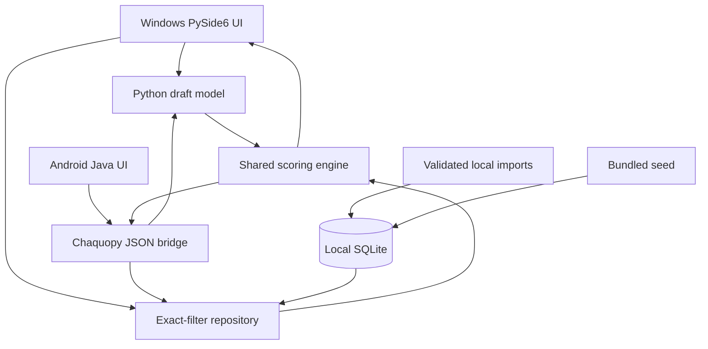

# Architecture

## Shared core and native interfaces

Android embeds Python in the app process, not a remote server. Gradle copies selected shared sources into generated directories and excludes the Windows Qt interface.

## Domain and storage

`domain/draft.py` owns immutable snapshots, validation and undo. Commands validate the complete proposed state before committing it. Champion swaps and role swaps are separate atomic operations. `domain/roster.py` resolves canonical names and aliases; portraits use local files with text fallback.

`storage/database.py` applies versioned migrations. `storage/importer.py` validates provenance, roles, exact grains, counts and pair-to-baseline consistency before atomic writes. Normalized hashes identify snapshots and make identical reimports idempotent.

`storage/repository.py` reads one exact dataset/patch/rank/region snapshot. Dataset-specific attributes isolate imported DEMO composition values from real datasets. GLOBAL and individual-league counts are alternative filters, never summed.

`storage/bootstrap.py` copies the seed into writable storage on first use and preserves corrupt databases before recovery. A valid existing database is retained. Replacing the APK seed asset does not automatically replace an existing private database: the solo-queue transition needs an explicit update path preserving imports and drafts.

`storage/session.py` validates versioned draft JSON and writes atomically. Preferences are separate. Undo is session-only.

## Scoring and scheduling

`recommendation/engine.py` consumes a draft, filtered snapshot and settings without network access or database mutation. It excludes picks/bans, checks role/sample support and returns candidate scores, evidence and warnings. See [SCORING.md](SCORING.md) for formulas.

Windows uses NumPy percentiles; Android uses a parity-tested standard-library implementation. Pandas prepares historical data and is not packaged into the scoring runtimes.

Windows runs analysis on a Qt thread pool. Android serializes commands and analysis on a background executor. Both debounce 120 ms and reject stale results using generation identifiers. Exact-filter snapshots are cached; Android keeps at most two. UI rendering stays on the native UI thread.

## Platform storage and packaging

Windows uses `%LOCALAPPDATA%\LeagueDraftAssistant` or `--data-dir`. Android uses app-private files and the system document picker for import/export, with no broad storage permission. Android saving starts enabled; Windows draft recovery is opt-in. Android backup is disabled. There is no telemetry/cloud sync.

The source includes portraits, the aggregate seed, provenance, notices and build pins. Raw histories, private signing keys, user drafts, logs and caches are excluded. Windows uses PyInstaller; Android uses Gradle/AGP and Chaquopy with ARM64/x86_64 targets. Current Android release-mode builds use a local development key; production signing remains future work.
